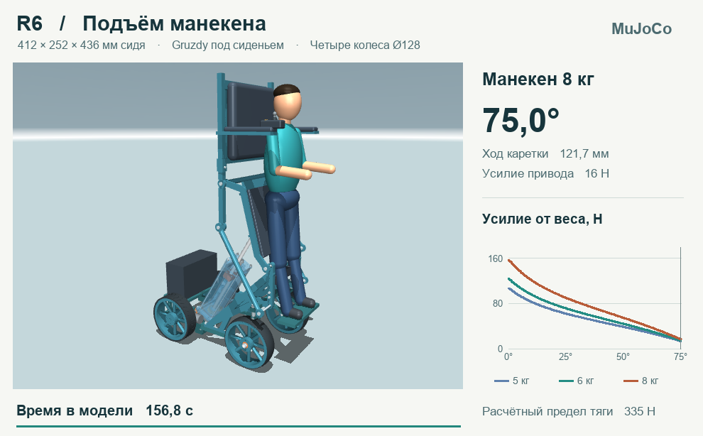

# Вертикализатор · R6

Настольный макет с линейным актуатором Gruzdy. В проекте есть сборки FreeCAD, файлы для 3D-печати, модель движения в MuJoCo и результаты расчётов. R6 рассчитан на испытания с манекеном и балластом. Допустимая нагрузка физического экземпляра ещё не установлена.



## Печать на принтере 256 × 256 × 256 мм

| Что уже есть | Что печатать | Комплект |
|---|---|---|
| Актуатор уже напечатан, весь макет из PETG | 23 детали на 9 столах. Столы 01–09, четыре цельных колеса, обе монтажные вилки | [Скачать ZIP для PETG](https://github.com/Jojoky7/VerticaliZaotr/raw/refs/heads/main/model/R6_Печать_256_без_актуатора.zip) |
| Нужны актуатор и отдельные шины TPU | Базовый R6, 37 деталей на 12 столах. Диски на столах 09–10, шины TPU на 11–12 | [Скачать полный исходный ZIP](https://github.com/Jojoky7/VerticaliZaotr/raw/refs/heads/main/model/R6_Печать_256.zip) |

**Для варианта PETG начните с [иллюстрированной инструкции](model/R6/Печать%20256%20без%20актуатора/Сборка%20R6%20PETG.pdf).** В ней есть перечень крепежа, схемы десяти этапов и проверка каждого узла. На столе 00 четыре образца для проверки посадок. Сборочные столы 01–09 рассчитаны на печать в масштабе 100%. На готовом актуаторе нужны заднее крепление и проушина штока под пальцы Ø6 мм.

- [Столы PETG](model/R6/Печать%20256%20без%20актуатора/Столы) · [раскладка FreeCAD](model/R6/Печать%20256%20без%20актуатора/R6_Без_актуатора.FCStd) · [сборка PETG с крепежом](model/R6/Печать%20256%20без%20актуатора/R6_PETG.FCStd)
- [Разрез шарнира рамы](model/R6/Печать%20256%20без%20актуатора/Шарнир%20стойки.png) · [проверка геометрии и нарезки PETG](model/R6/Печать%20256%20без%20актуатора/Проверки.json) · [построение CAD-варианта PETG](model/R6/build_petg.py)
- [Полная базовая раскладка с отдельными шинами](model/R6/Печать%20256) · [поштучные STL базового R6](model/R6/STL)

## Модель и движение

| Материал | Где открыть |
|---|---|
| Сборка R6 в FreeCAD | [Положение сидя, 0°](model/R6/R6_0deg.FCStd) · [Подъём, 75°](model/R6/R6_75deg.FCStd) |
| Движение с манекеном | [Запись подъёма](model/R6/R6_8kg.gif) · [сцена MuJoCo](model/R6/R6_Gruzdy.xml) |
| Геометрия, нагрузки, зазоры и запуск симуляции | [Размеры и испытания](model/R6/Размеры%20и%20испытания.md) · [отчёты и расчётные модели](model/R6/verification) |
| Источники для генерации R6 | [Генератор FreeCAD](model/R6/build_cad.py) · [исходная сборка R2](model/Verticalizator_R2.FCStd) · [STEP актуатора](model/inputs/Сборка.stp) |

Из корня репозитория можно проверить сохранённые результаты расчётов.

```sh
python3 model/R6/verify.py --reports-only
```

## Предыдущие версии и симулятор с пультом

- [R2](model/R2) — ранние модели, экспорт OBJ, запись подъёма и комплект компактной рамы. [R3](model/R3) — CAD, раскладка, STL и симуляция Gruzdy.
- [R4](model/R4) и [R5](model/R5) — промежуточные ревизии со своими сценами, расчётами и деталями.
- [Симулятор с веб-пультом](VerticaliZaotr) — локальная версия с Mac, материалы и скрипты запуска для macOS, Windows и Linux. [Инструкция](VerticaliZaotr/ИНСТРУКЦИЯ.txt) · [предыдущая версия с GitHub](https://github.com/Jojoky7/VerticaliZaotr/tree/742653ec09345d4d5d3196d1c83231d1df32cef2).
